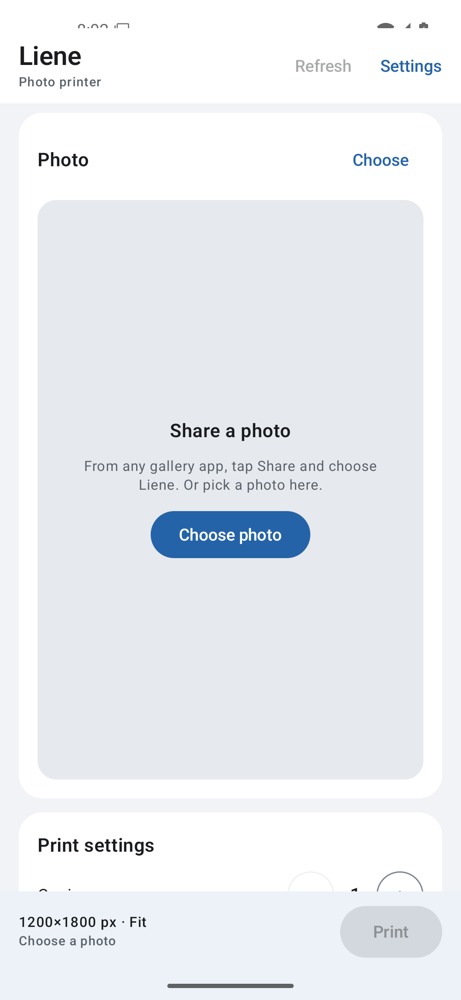
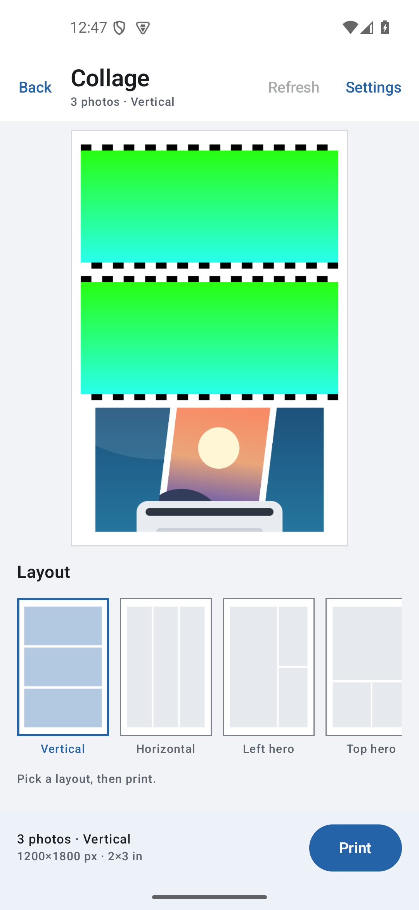

# Liene Android App (Unofficial)

[](https://github.com/bydavy/liene-printer-android-app/actions/workflows/android.yml)
[](https://github.com/bydavy/liene-printer-android-app/releases/latest)
[](LICENSE)
[](https://ko-fi.com/davyleggieri)
[](https://www.buymeacoffee.com/davyleggieri)

An unofficial, open-source Android app for **Liene/Hannto photo printers**,
written in Kotlin with Jetpack Compose. Share a photo from any gallery app,
frame it for a 2×3 print, and send it over Bluetooth Classic SPP — no vendor
app required.

> **Not affiliated with Liene or Hannto.** This is an interoperability project
> for a printer we own. No vendor app code, firmware, or assets are
> redistributed. Liene and Pearl are trademarks of their respective owners.

## Why this app exists

The main motivation is the **share-to-print flow**. Browse and edit photos in
whatever gallery app you already use — Google Photos, your camera roll, or any
third-party gallery — then tap Share → **Liene**. The app takes over only the
print-specific part: 2:3 framing, copies, printer status, and upload.

The official Liene app's built-in gallery experience is poor: finding and
selecting a photo is slower and more awkward than using the gallery app you
already know. This project exists so you never have to use the vendor app's
photo browser to print a photo.

There is also **no account or sign-in**. Open the app, share a photo, and
print — everything stays local over Bluetooth, with no cloud dependency.

The protocol was reverse-engineered and hardware-tested by the companion
[Liene Desktop App](https://github.com/bydavy/liene-printer-desktop-app). The
Android client has been hardware-tested on a **Pixel 11 Pro (Android 17)** with
an N200 Pro: share, Bluetooth connection, status, and printing all work. Other
Liene/Hannto models remain untested.





## Features

- **Share target**: from Google Photos or any gallery, tap Share → **Liene**.
  Share several photos at once to jump straight into a collage.
- **Collage**: pick 2–4 photos, choose vertical, horizontal, focused, or grid
  layouts, then print from a dedicated preview screen with copies.
- **Mobile-first editor**: rotate, Fit/Fill framing, pinch-to-zoom and drag,
  2:3 print preview with white borders for Fit.
- **Final confirmation**: a full 2:3 preview and summary before any print job
  starts.
- **Print settings**: copies 1–9, fixed 1200×1800 output, JPEG compressed to
  the printer's ~1 MiB transfer target.
- **Printer status**: state, battery, alerts, model/serial/firmware, and
  resume/cancel.
- **Background printing**: a foreground service keeps the job alive and shows
  upload/print progress in a notification.
- **Light and dark Material 3 themes**, following the system appearance.
- **Offline and private**: no accounts, analytics, network calls, or storage
  permissions.

## Supported printers

| Model | Internal name | PID | Status |
| --- | --- | --- | --- |
| Liene Pearl N200 Pro | `cumin` | 3015 | **Tested** on Pixel 11 Pro, Android 17 |
| Liene PixCut S1 | `perilla` | 3101 | Untested; help wanted |
| Liene Amber M110/M210 | `laurel` | 3007 | Untested; help wanted |
| Liene Photo Printer | `fennel` | 3005 | Untested; help wanted |
| Portable Photo Printer | `kiwi` | 1021 | Untested; help wanted |

The app looks for a paired Bluetooth Classic device with “Liene”, “Pearl”, or
“Hannto” in its name. Other models may share the protocol but need testers.

## Requirements

- Android 8.0 (API 26) or newer. Developed against Android 15 / API 35.
- A supported printer, paired in Android's Bluetooth settings.
- Android 12+ needs the **Nearby devices** (`BLUETOOTH_CONNECT`) permission.
- Android 13+ asks for notification permission when you start a print.

## Install

Download the latest APK from
[Releases](https://github.com/bydavy/liene-printer-android-app/releases/latest),
open it, and allow installs from your browser/file manager if prompted.

The release workflow produces an APK signed with a debug key unless release
signing secrets are configured, so it is suitable for sideloading and testing,
not for Play Store distribution.

1. Pair the printer in **Settings → Bluetooth & devices** (the device is named
   `Liene Pearl N200 Pro-XXXX` on the N200 Pro).
2. Open the app and tap **Connect**, granting Nearby devices access.
3. From a gallery app, share a photo to **Liene** (or use **Choose** in the
   app), frame it, and tap **Print**.
4. For a collage, tap **Collage** and select 2–4 photos — or share several
   photos at once. Pick a layout, tap **Print**, then choose copies and print.
5. Keep the printer powered on while the job uploads and prints.

## Build

Requirements: JDK 17, Android SDK 35, and a rustup-free Android toolchain (no
Rust is needed for this app).

```sh
./gradlew :app:assembleDebug
./gradlew :app:testDebugUnitTest
./gradlew :app:lintDebug
```

The debug APK is at `app/build/outputs/apk/debug/app-debug.apk`.

For a release build signed with a real keystore:

```sh
export LIENE_KEYSTORE_PATH=/path/to/liene.jks
export LIENE_KEYSTORE_PASSWORD=...
export LIENE_KEY_ALIAS=...
export LIENE_KEY_PASSWORD=...
./gradlew :app:assembleRelease -PappVersionName=0.1.2 -PappVersionCode=3
```

Without those variables, `assembleRelease` falls back to debug signing.

## How it works

- **Kotlin/Compose** UI and a native Kotlin Bluetooth transport. Android
  exposes Bluetooth Classic RFCOMM through `BluetoothSocket`; a Rust core
  would still need a Kotlin transport, so this client keeps the protocol in
  Kotlin and shares the byte-level spec with the desktop project.
- **Protocol**: frames, checksums, JSON-RPC methods, media constants, and
  892-byte chunk uploads are documented in
  [PROTOCOL.md](https://github.com/bydavy/liene-printer-desktop-app/blob/main/docs/PROTOCOL.md).
- **RFCOMM**: the printer's data channel is channel 1. The client first tries
  Android's SPP service-record lookup, then falls back to the direct channel
  (as the desktop client does).
- **Foreground service**: Android may kill a backgrounded activity during a
  multi-minute print, so `PrintService` owns the job and posts progress.
- **Image pipeline**: shared `content://` URIs are copied to cache, EXIF
  orientation is applied, the image is downsampled for memory, and the final
  JPEG is rendered at 1200×1800 before upload.

## Tests

```sh
./gradlew :app:testDebugUnitTest
```

Unit tests cover frame encoding/decoding, checksums, stream resynchronisation,
JSON-RPC shapes, chunking, job parsing, and the Fit/Fill/zoom math. The image
pipeline has instrumented tests; run them on an emulator or phone with:

```sh
./gradlew :app:connectedDebugAndroidTest
```

Hardware tests require a printer; please open a
[Printer support report](https://github.com/bydavy/liene-printer-android-app/issues/new?template=printer-support.md)
with model, PID, firmware, Android version/device, and a Diagnostics log.
Share, Bluetooth connect, status, and printing were verified on a Pixel 11 Pro
(Android 17) with an N200 Pro. The UI and image pipeline are also smoke-tested
on an Android 15 emulator.

## Releasing

Push a `v*` tag. `.github/workflows/release.yml` builds
`Liene-Android-<version>.apk` plus a SHA-256 file. For a proper release
signature, add these repository secrets:

- `LIENE_KEYSTORE_BASE64`
- `LIENE_KEYSTORE_PASSWORD`
- `LIENE_KEY_ALIAS`
- `LIENE_KEY_PASSWORD`

Without them, the APK is debug-signed for testers. The app is not on the Play
Store; Bluetooth permission review and Play signing can be added later.

## Privacy

The app has no internet permission and does not collect or upload anything.
Photos are read only after you share or pick them, are copied to the app cache
for processing, and the prepared JPEG is deleted after the print attempt.

## Acknowledgements

Protocol work and the desktop client:
[bydavy/liene-printer-desktop-app](https://github.com/bydavy/liene-printer-desktop-app).
Prior community work on the Liene PixCut S1:

- [sincethestudy/liene-pixcut-s1-api](https://github.com/sincethestudy/liene-pixcut-s1-api)
- [eastbaymakersclub/pixcut-s1](https://github.com/eastbaymakersclub/pixcut-s1)

## License

MIT — see [LICENSE](LICENSE).
